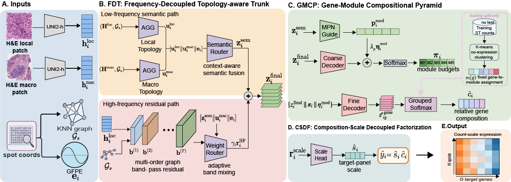

# TRACE: Topology-Aware Reconstruction through Hierarchical Composition and Expression-Scale Decoupling for Spatial Gene Expression Prediction

## Overview

TRACE is a deterministic framework for predicting spatial gene expression from H&E histology images. It uses frozen pathology image features together with spatial topology, hierarchical gene-module composition, and expression-scale factorization to reconstruct spot-level gene expression.

A central component of TRACE is the **Frequency-Decoupled Topology-aware Trunk (FDT)**, which models topology-smoothed tissue semantics and local graph band-pass variation through complementary pathways. TRACE further introduces the **Gene-Module Compositional Pyramid (GMCP)** to organize high-dimensional gene decoding through a module-to-gene hierarchy, and **Composition–Scale Decoupled Factorization (CSDF)** to separate relative gene composition from target-panel expression scale.

Using precomputed histology features, TRACE performs inference with a single deterministic forward pass, without test-time spatial transcriptomics data, reference-sample retrieval, or iterative sampling.



## System environment

Required packages:

- Python >= 3.10
- PyTorch
- Scanpy / AnnData
- scikit-learn
- h5py
- timm
- huggingface_hub

Install the required packages with:

```bash
python -m pip install -U pip
python -m pip install -r requirements.txt
```

TRACE supports frozen image features from ResNet50, UNI, and UNI2-h. UNI and UNI2-h require access to the official MahmoodLab Hugging Face repositories.

```bash
huggingface-cli login
```

## Datasets

TRACE is evaluated on four public spatial transcriptomics datasets:

- HER2ST
- PRAD
- Kidney
- Healthy Mouse Brain

The ordered 200-gene target panels are provided in `gene_lists.json`. All slides within the same experiment must use the same genes in the same order.

The preprocessing workflow expects filtered `.h5ad` files and the corresponding H&E whole-slide images. Each processed slide stores frozen local and macro histology features, spatial coordinates, a spatial k-nearest-neighbor graph, and count-scale gene expression.

## Repository Structure

```text
TRACE/
├── gene_lists.json
├── requirements.txt
├── Fig1_TRACE_overview.png
├── scripts/
│   ├── build_processed_data.py
│   ├── build_gene_modules.py
│   ├── train_genar.py
│   └── infer_genar.py
├── src/
│   ├── configs/
│   │   └── example.yaml
│   ├── data.py
│   ├── features.py
│   ├── models/
│   │   ├── fdt.py
│   │   ├── gmcp.py
│   │   └── trace.py
│   ├── training.py
│   └── utils.py
└── README.md
```

## TRACE pipeline

- Run `build_processed_data.py` to extract frozen local and macro histology features and construct the spatial graph.
- Run `build_gene_modules.py` to construct fixed gene modules from the training slides only.
- Run `train_genar.py` to train TRACE.
- Run `infer_genar.py` for inference and evaluation on the held-out slide.

### 1. Build processed slide-level data

```bash
python scripts/build_processed_data.py \
  --h5ad_dir path/to/filtered_h5ad \
  --wsi_dir path/to/wsi \
  --out_dir processed_data_example \
  --dataset_name DATASET \
  --backbone uni2-h \
  --local_size 224 \
  --macro_size 1024 \
  --graph_k 10 \
  --batch_size 8
```

### 2. Define the train/test split

Edit `src/configs/example.yaml`:

```yaml
data:
  data_dir: processed_data_example
  train_samples: AUTO_EXCEPT_VAL_TEST
  test_samples:
    - TEST_SAMPLE
  gene_module_dir: processed_data_example/gene_modules_k10
```

### 3. Build training-only gene modules

```bash
python scripts/build_gene_modules.py \
  --config src/configs/example.yaml \
  --seed 42
```

The gene-to-module assignment is constructed from training-slide expression only and is fixed during model training and inference.

### 4. Train TRACE

```bash
python scripts/train_genar.py \
  --config src/configs/example.yaml
```

### 5. Inference and evaluation

```bash
python scripts/infer_genar.py \
  --config src/configs/example.yaml \
  --model_path auto:last \
  --test_sample TEST_SAMPLE \
  --output_file results/example_prediction.h5 \
  --save-target-for-eval
```

With `--save-target-for-eval`, the output additionally contains ground-truth expression and evaluation metrics. Without this flag, the saved file contains predictions and metadata only.

## Notes

- Gene modules must be fitted from training slides only and must not use the held-out test slide.
- The same target-gene order must be used across all slides within an experiment.
- Pathology features are extracted offline and the image encoder is frozen during TRACE training.
- `example.yaml` is a runnable template; dataset paths, held-out samples, and experiment-specific settings should be adjusted before training.

## Contact details

If you have any questions, please contact Bo Li at `libo@wust.edu.cn`.
